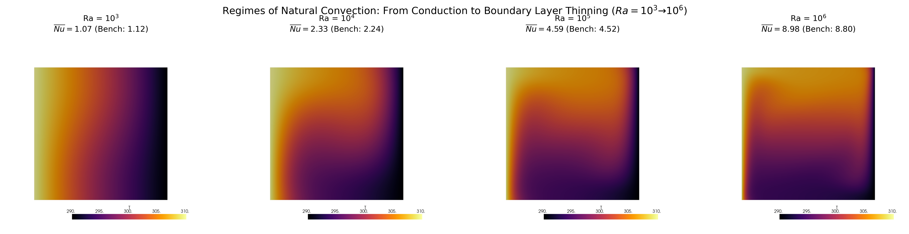
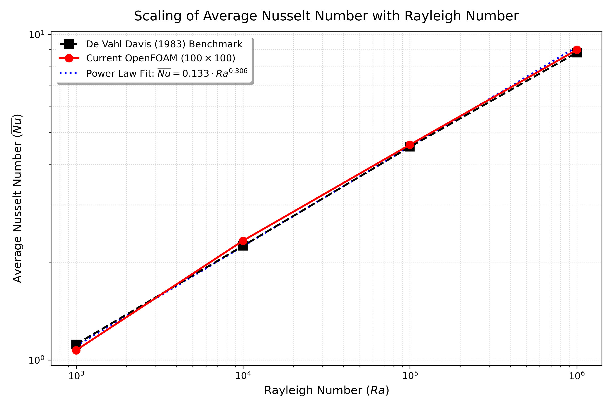
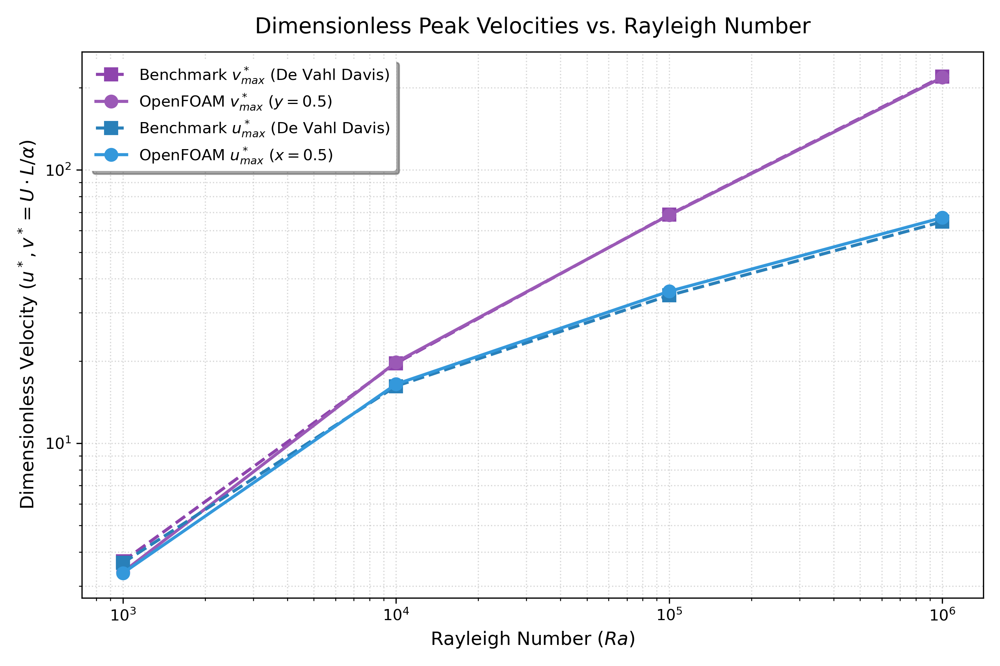
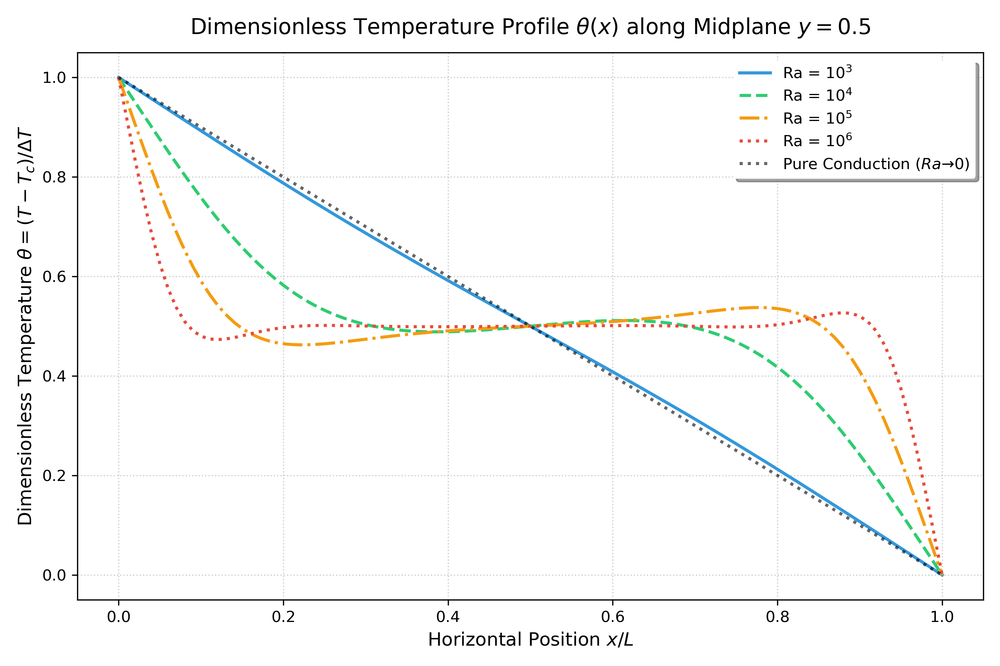
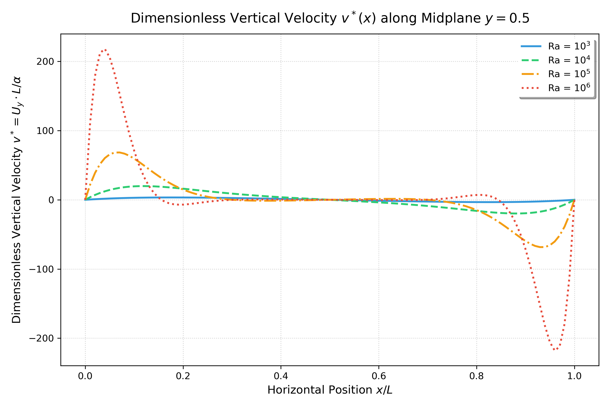
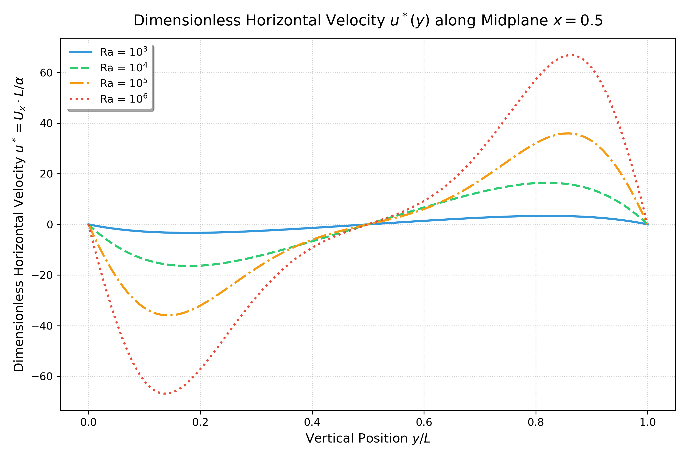
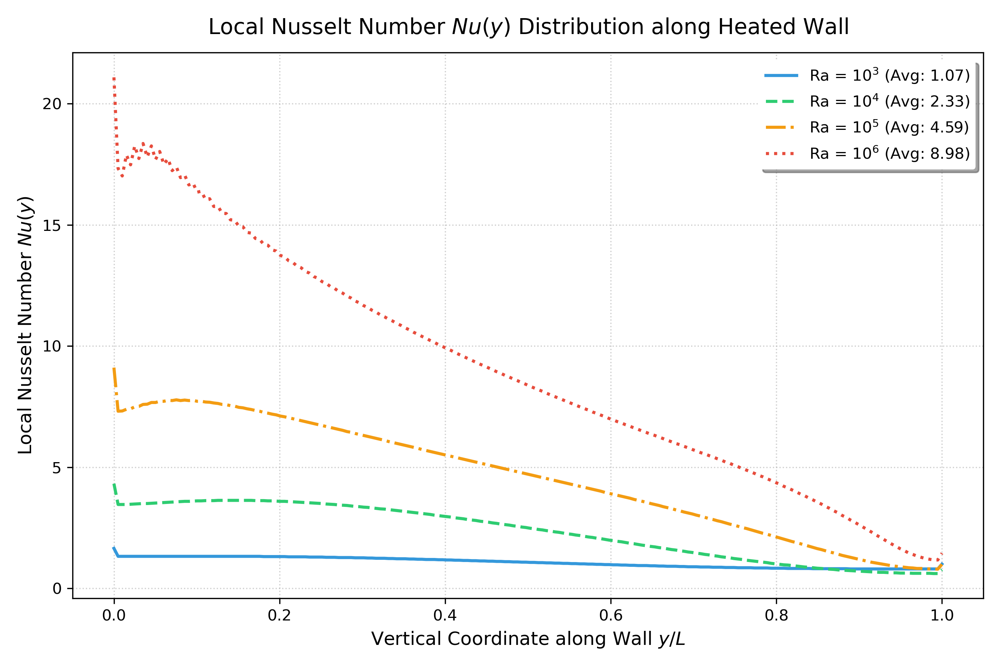

# Rayleigh-Number Sweep: De Vahl Davis Benchmark

This study compares steady laminar OpenFOAM solutions for the differentially heated square cavity at four Rayleigh numbers with the benchmark of De Vahl Davis (1983). It is intended as a reproducible teaching example and an illustration of natural-convection trends, not a formally uncertainty-qualified CFD result.

## Problem definition

The two-dimensional cavity has width and height $L=H=1$ m. Its left vertical wall is hot ($T_h=310$ K), its right vertical wall is cold ($T_c=290$ K), and the horizontal walls are adiabatic. All solid walls are no-slip. Gravity is $(0,-9.81,0)$ m s$^{-2}$. The front and back faces use `empty`; the computational block is 1 m × 1 m × 0.1 m with one cell through the depth.

The Boussinesq model uses the fixed reference temperature $T_0=300$ K and expansion coefficient $\beta=1/T_0=1/300$ K$^{-1}$. The temperature difference is $\Delta T=20$ K. Air is treated as a constant-property Newtonian fluid with $Pr=0.71$.

$$
Ra=\frac{g\beta\Delta T L^3}{\nu\alpha}
 =\frac{g\beta\Delta T L^3Pr}{\nu^2},
\qquad
Pr=\frac{\nu}{\alpha}.
$$

The prescribed viscosity and diffusivity are calculated from

$$
\nu=\sqrt{\frac{g\beta\Delta T L^3Pr}{Ra}}
 =\sqrt{\frac{0.46434}{Ra}},
\qquad \alpha=\frac{\nu}{Pr}.
$$

| Case | $Ra$ | $\nu$ (m$^2$/s) | $\alpha$ (m$^2$/s) |
|---|---:|---:|---:|
| `cases/Ra_1e3` | $10^3$ | $2.154855\times10^{-2}$ | $3.035007\times10^{-2}$ |
| `cases/Ra_1e4` | $10^4$ | $6.814250\times10^{-3}$ | $9.597535\times10^{-3}$ |
| `cases/Ra_1e5` | $10^5$ | $2.154855\times10^{-3}$ | $3.035007\times10^{-3}$ |
| `cases/Ra_1e6` | $10^6$ | $6.814250\times10^{-4}$ | $9.597535\times10^{-4}$ |

## Numerical procedure

- **Solver:** `buoyantBoussinesqSimpleFoam`, steady incompressible Boussinesq flow.
- **Mesh:** uniform structured $100\times100\times1$ cells in every case.
- **Pressure-velocity coupling:** SIMPLE.
- **Convection:** `bounded Gauss upwind` for `div(phi,U)` and `div(phi,T)`; this is first-order upwind, not second-order linear upwind.
- **Other schemes:** Gauss linear gradients and corrected Gauss linear Laplacians (see each `system/fvSchemes`).
- **Sampling:** 200 points on each mid-plane and 200 points on a line at $x=0.005$ m near the hot wall.

The velocity components are non-dimensionalized using thermal diffusivity:

$$
u^*=\frac{uL}{\alpha},\qquad v^*=\frac{vL}{\alpha}.
$$

The local hot-wall Nusselt estimate is sampled at the first near-wall line:

$$
Nu(y)\approx\frac{T_h-T(x_s,y)}{\Delta T\,x_s/L},
\qquad x_s=0.005\ {\rm m},
\qquad
\overline{Nu}\approx\frac{1}{N}\sum_{j=1}^{N}Nu(y_j).
$$

Here $x_s$ is the first cell-center distance from the hot wall in the 100-cell mesh. The arithmetic sample mean approximates the wall integral; it is not a direct boundary-face gradient evaluation. `postprocess_benchmark_sweep.py` selects the positive maximum of $U_x$ at $x/L=0.5$ and the positive maximum of $U_y$ at $y/L=0.5$. This makes the horizontal-velocity peak location comparable to the positive-branch benchmark coordinate rather than the equal-magnitude negative branch.

## Quantitative results

| $Ra$ | Quantity | OpenFOAM | De Vahl Davis (1983) | Relative error | CFD location (benchmark location) |
|---:|---|---:|---:|---:|---|
| $10^3$ | $\overline{Nu}$ | 1.072 | 1.118 | 4.13% | Hot wall |
|  | $u^*_\max$ | 3.35 | 3.649 | 8.22% | $y/L=0.819$ (0.813) |
|  | $v^*_\max$ | 3.38 | 3.697 | 8.65% | $x/L=0.171$ (0.178) |
| $10^4$ | $\overline{Nu}$ | 2.326 | 2.243 | 3.71% | Hot wall |
|  | $u^*_\max$ | 16.45 | 16.178 | 1.67% | $y/L=0.819$ (0.823) |
|  | $v^*_\max$ | 19.79 | 19.617 | 0.88% | $x/L=0.121$ (0.119) |
| $10^5$ | $\overline{Nu}$ | 4.586 | 4.519 | 1.47% | Hot wall |
|  | $u^*_\max$ | 35.96 | 34.730 | 3.53% | $y/L=0.859$ (0.855) |
|  | $v^*_\max$ | 68.37 | 68.590 | 0.31% | $x/L=0.070$ (0.066) |
| $10^6$ | $\overline{Nu}$ | 8.975 | 8.800 | 1.99% | Hot wall |
|  | $u^*_\max$ | 66.88 | 64.630 | 3.48% | $y/L=0.859$ (0.850) |
|  | $v^*_\max$ | 217.86 | 219.360 | 0.68% | $x/L=0.040$ (0.0379) |

Rounded values above are generated at full precision in [`results/benchmark_validation_summary.csv`](results/benchmark_validation_summary.csv) and summarized in [`results/benchmark_validation_summary.md`](results/benchmark_validation_summary.md). The largest errors are the velocity peaks at $Ra=10^3$ (8.22% and 8.65%); it would be misleading to describe every reported quantity as agreeing within 4.1%.

## Findings and interpretation

1. **Heat transfer increases with buoyancy.** The estimated mean Nusselt number rises from 1.072 at $Ra=10^3$ to 8.975 at $Ra=10^6$, a factor of about 8.4. The $Ra=10^3$ result remains close to the conduction limit $\overline{Nu}=1$.
2. **A four-point log-log regression gives** $\overline{Nu}=0.1331Ra^{0.3064}$. The regression is descriptive for these four points only; it is not a general correlation or an independent validation.
3. **Vertical circulation intensifies and its sampled peak moves toward the hot wall.** $v^*_\max$ rises from 3.38 to 217.86, while $x_{v_\max}/L$ moves from 0.171 to 0.040. The movement is consistent with a thinner near-wall region at increasing $Ra$, but four peak locations do not establish a $\delta\sim Ra^{-1/4}$ law.
4. **The horizontal peak turns toward the top/bottom boundary layers.** The positive $u^*_\max$ is found at $y/L\approx0.819$ for $Ra=10^3$ and $10^4$, and $y/L\approx0.859$ for $Ra=10^5$ and $10^6$. The opposite-signed return-flow peak has similar magnitude and is not the coordinate reported in the benchmark table.
5. **Profiles show a change from cavity-wide conduction toward wall-dominated gradients.** The temperature mid-plane increasingly flattens in the core while gradients concentrate near the vertical walls. Vertical velocity is concentrated near the side-wall regions at the higher Rayleigh numbers.
6. **Benchmark agreement depends on metric and Rayleigh number.** Nusselt errors range from 1.47% to 4.13%; horizontal peak errors from 1.67% to 8.22%; and vertical peak errors from 0.31% to 8.65%.

The figures provide visual context for these findings:















## Reproduction

Requirements: OpenFOAM.com v2512 or a compatible OpenFOAM environment with `blockMesh` and `buoyantBoussinesqSimpleFoam`; Python 3 with NumPy, pandas, Matplotlib, and PyVista.

```bash
cd 05_rayleigh_validation_sweep
./Allrun
```

The master runner executes each case and then the post-processor. Each case writes `log.blockMesh` and `log.foam`; sampling CSVs are written beneath `cases/Ra_*/postProcessing/`. Summary tables and figures are written to `results/`. To post-process existing case output without rerunning the solvers:

```bash
python3 scripts/postprocess_benchmark_sweep.py
```

The script fails explicitly if a required sample or case solution time is missing. Run a single case from its own directory, for example:

```bash
cd cases/Ra_1e5
./Allrun
```

## Directory contents

- `cases/Ra_1e3` through `cases/Ra_1e6`: solver inputs and generated case outputs.
- `scripts/postprocess_benchmark_sweep.py`: extraction, scaling, comparisons, and figures.
- `results/benchmark_validation_summary.csv`: full-precision comparison values.
- `results/benchmark_validation_summary.md`: readable benchmark table.
- `results/*.png`: plots and contour figures used in the study.
- `Allclean`: removes case outputs and files inside `results/`; inspect it before use if you need to preserve generated assets.

## Limitations

- One uniform 100 × 100 mesh is used at each Rayleigh number; the sweep does not include a mesh-convergence study or discretization uncertainty estimate.
- Bounded Gauss upwind is first-order for the convective terms and can numerically diffuse gradients.
- The reported mean Nusselt number uses a finite-difference temperature estimate at the first near-wall cell center and a line-sample mean. It is sensitive to the sampling distance and mesh.
- The script's peak-velocity locations are limited by the 200-point line sampling; location differences of a few thousandths of $L$ should not be overinterpreted.
- The solver is steady and laminar in all four cases. These calculations do not identify a laminar-to-unsteady or turbulent transition.
- Constant properties, ideal boundary conditions, and 2D geometry exclude effects present in many engineering enclosures.

## Reference

De Vahl Davis, G. (1983). “Natural convection of air in a square cavity: A bench mark numerical solution.” *International Journal for Numerical Methods in Fluids*, 3(3), 249–264. [https://doi.org/10.1002/fld.1650030305](https://doi.org/10.1002/fld.1650030305).
